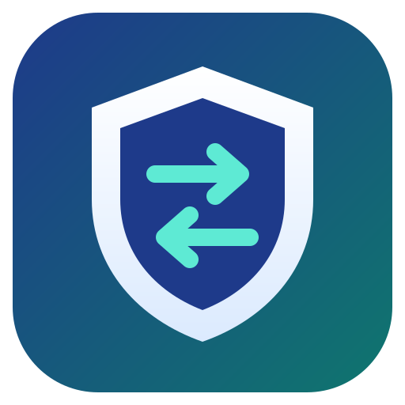

<p align="center"></p>

# Wireproxy GUI

Wireproxy GUI is a small Go desktop app built on lobe-mygo, for running WireGuard- or
Tailscale-backed SOCKS5 proxies from a native GUI and system tray. It manages
multiple saved profiles, starts each connection in-process through the embedded
WireGuard engine or an embedded Tailscale `tsnet` node, and does not shell out to
the `wireproxy`, `tailscale`, or `tailscaled` command-line tools.

The app is intended for users who already have WireGuard profile files or a
Tailscale tailnet and want each profile exposed as a local SOCKS5 listener, such
as `127.0.0.1:1080`.

## Features

- Add WireGuard or Tailscale profiles manually, or import WireGuard `.conf`
  files.
- Import and export JSON profile bundles.
- Run multiple profiles at the same time with separate SOCKS5 bind addresses.
- Connect or disconnect one profile, or connect/disconnect every saved profile.
- Forward local TCP and UDP ports to targets reached through a profile, like
  `ssh -L` (see [Local Forwards](#local-forwards)).
- Show profile status in the sidebar and tray menu.
- Show the SOCKS5 bind address and backend detail for each profile.
- Register an embedded Tailscale device with an auth key or browser sign-in.
- Select a Tailscale exit node manually, by node ID, MagicDNS base name, or IP,
  or with automatic mode.
- Follow each profile log by default, with scrollback preserved when you scroll up.
- Auto-connect selected profiles when the app opens.
- Use native file dialogs for import and export.
- Hide to tray on window close when tray support is available.
- On macOS, optionally hide the Dock icon from the tray menu. The setting is kept
  in `wireproxy-gui/gui.json` under the user config directory; a value saved by
  earlier Fyne builds is migrated once.
- Stop active profiles during app shutdown and wait briefly for listeners to close.

## Install (macOS)

```sh
brew install --cask NRngnl/tap/wireproxy-gui
```

The [tap](https://github.com/NRngnl/homebrew-tap) tracks the latest GitHub release.

## Requirements

- Go 1.27.3.
- macOS, Linux, or Windows. Builds are pure Go (`CGO_ENABLED=0`).
- Linux runtime: GTK 3 for the window and file dialogs; the tray icon also needs
  `libayatana-appindicator3` and `libdbusmenu`. Without them the app runs
  without a tray, and closing the window quits.
- `mise` is optional, but the repo includes `.mise.toml` for tool pinning.
- No separate `wireproxy`, `tailscale`, or `tailscaled` binary is required.

Import and export use the platform file dialog (GTK on Linux).

## Install Tools

With `mise`:

```sh
mise install
```

Without `mise`, install a compatible Go toolchain and `golangci-lint` yourself.

## Run From Source

```sh
go run ./cmd/wireproxy-gui
```

Or with `mise`:

```sh
mise run build
./bin/wireproxy-gui
```

## Build

Build the executable:

```sh
go build -o bin/wireproxy-gui ./cmd/wireproxy-gui
```

The local macOS app bundle used during development is:

```text
dist/Wireproxy GUI.app
```

That bundle is generated outside Git and is ignored by the repository. To install
it on macOS, copy the `.app` bundle into `/Applications` or run it in place.

## Release Builds

The project version is stored in [VERSION](VERSION) and is managed by
[release-please](https://github.com/googleapis/release-please): merging
Conventional Commits to `main` updates a release PR that bumps `VERSION` and
`CHANGELOG.md`. Merging that PR creates the tag and release after approval in the
`release` environment (owner only), using the `RELEASE_TOKEN` environment secret, and the tag push builds artifacts. Release builds inject the
version, commit, and UTC build time into the binary.

Build a release artifact for the native OS and architecture:

```sh
scripts/build-release.sh
```

Cross-build any target from any host; no C toolchain is needed:

```sh
RELEASE_VERSION=0.1.0 GOOS=darwin GOARCH=arm64 scripts/build-release.sh
```

Artifacts are written to:

```text
dist/release/artifacts/
```

The macOS release artifact is a zipped `.app` bundle. Linux releases are
`.tar.gz` archives. Windows releases are `.zip` archives. Each artifact gets a
neighboring `.sha256` checksum file.

GitHub Actions builds releases automatically when a version tag such as `0.1.0`
or `v0.1.0` is pushed. The workflow cross-compiles Windows and builds Linux
and macOS on their own runners, all with `CGO_ENABLED=0`.

## Test And Lint

```sh
go test ./...
go vet ./...
golangci-lint run
```

The repo also exposes the common commands through `mise`:

```sh
mise run test
mise run lint
```

## Profile Storage

Profiles are stored in the current user's OS config directory:

```text
<user-config-dir>/wireproxy-gui/profiles.json
```

On macOS this is normally:

```text
~/Library/Application Support/wireproxy-gui/profiles.json
```

The profile directory is created with owner-only permissions, and profile JSON is
written with `0600` permissions where the platform supports it.

## WireGuard Profiles

Imported WireGuard files must include the usual required sections and keys:

```ini
[Interface]
Address = ...
PrivateKey = ...

[Peer]
PublicKey = ...
AllowedIPs = ...
Endpoint = ...
```

The GUI stores the WireGuard configuration text you provide. When a profile is
started, it removes any existing `[Socks5]` section from that text, defaults
`PersistentKeepalive` to `25` seconds on any `[Peer]` section that omits it
(preserving valid explicit values including `0`), and injects the profile's
selected bind address:

```ini
[Socks5]
BindAddress = 127.0.0.1:1080
```

Use a unique SOCKS5 bind address for every profile you run at the same time.

## Tailscale Profiles

Tailscale profiles run an embedded `tsnet` node with one state directory per
profile. Paste an auth key and click Login or Connect to register this app as a
Tailscale device. Leave the auth key empty to use the browser sign-in URL written
to the profile log.

If Tailscale requires device approval, the profile log asks you to approve the
device in the Tailscale admin console and the app continues automatically after
approval. After authentication succeeds, the saved auth key is removed from the
profile and the auth field shows Authenticated. Click Logout to remove that
profile's stored Tailscale state and unlock auth again.

Exit-node choices are loaded manually. Connect the Tailscale profile, click
Refresh next to the exit-node field, and refresh again after tailnet device or
approval changes. You can also type a node ID, MagicDNS base name, or Tailscale
IP address manually. Automatic exit asks Tailscale to choose an available exit
node. While connected, change the exit-node mode, selected node, or LAN access
setting and click Save to apply it without reconnecting.

## Local Forwards

A local forward listens on this computer and relays each connection through a
connected profile to a target, like `ssh -L`. The relay runs in the embedded
backend's userspace network stack: no SOCKS5 hop, no host DNS, no host routing,
no kernel TUN, no root.

For example, TCP `127.0.0.1:2222` to `remote-pc:22` lets
`ssh -p 2222 user@127.0.0.1` reach `remote-pc` through the profile.

- Each rule has a protocol (TCP or UDP), a listen address and a target
  `host:port`. A rule is identified by its protocol and listen address. A bare
  listen port means `127.0.0.1`. The listen address must be an IP address;
  `::1`, `0.0.0.0`, `::` or a specific local IP are allowed.
- Tailscale targets: a MagicDNS full name, an unambiguous short name, a peer's
  Tailscale IP, or an IP inside a subnet route advertised by an online peer.
  The embedded node accepts subnet routes from your tailnet (RouteAll), so SOCKS5 connections of this profile also reach approved subnet routes, and a routed IP is only
  reachable when the route is advertised, approved and its router is online. Names are never resolved by the host. A target that matches no peer or route
  fails closed. If the tailnet has no peers yet, the dial waits for the first peer
  update, within the 30-second dial timeout.
- WireGuard targets: an IP address, or a name when the WireGuard config sets
  `DNS`. A name with no `DNS` fails with a clear error instead of using the host
  resolver.
- A listen address that is already in use gives that rule an error state
  ("port in use"). The profile and the other rules keep running. Change the rule
  or use Retry.
- Rules can be added, edited, removed and retried while the profile is
  connected, without reconnecting. Unchanged rules keep their live sessions.
  Removing a rule closes the connections that use it.
- In the terminal UI, press `f` on a profile to open its local forwards: `a` add,
  `e` edit, `d` remove, `r` retry, `esc` back.
- Timeouts match SOCKS5: 30 seconds to dial, 5 minutes TCP idle, 60 seconds to
  drain a half-close and 60 seconds UDP session idle.
- Rules are stored as `local_forwards` in the profile JSON. Older versions
  ignore the key, so a downgrade drops the rules.
- The daemon applies a profile's rules when it connects the profile. A profile that is
  already connected keeps its rules until it is disconnected and connected again, or
  the daemon restarts. A reload (`SIGHUP`) only starts profiles that are not running.

## Import And Export

Import accepts:

- WireGuard `.conf` files.
- JSON files previously exported by Wireproxy GUI.
- JSON arrays or single JSON profile objects with compatible fields.

Tailscale node state and the local authenticated marker are not exported.
Imported Tailscale profiles are treated as not authenticated and require Login
again.

Export writes a JSON bundle:

```json
{
  "version": 1,
  "profiles": []
}
```

Exported files are written with `0600` permissions where supported because they
may contain WireGuard private keys or saved Tailscale auth keys.

## Runtime Behavior

Each connected profile owns an embedded backend and SOCKS5 listener. WireGuard
profiles run the embedded WireGuard engine; Tailscale profiles run an embedded
tsnet node. The app tracks profile states as disconnected, connecting,
connected, disconnecting, or error. Runtime fields are locked while a profile is
active; disconnect the profile before changing backend, SOCKS5 bind, WireGuard
config, or Tailscale auth settings. Tailscale exit-node settings can be changed
while connected; click Save to apply the new exit-node preference to the running
embedded node. When a specific Tailscale exit node is configured, connecting waits
up to five seconds for tailnet peers to appear in the embedded node status before
applying the exit node and starting the SOCKS5 listener.

For Tailscale profiles, paste an auth key and click Login or Connect to register
the embedded `tsnet` node. Leave the auth key empty to use the browser sign-in
URL written to the profile log. If Tailscale requires device approval, the log
asks you to approve the device in the Tailscale admin console and the app
continues automatically after approval. Successful auth clears the saved auth key
and marks the profile authenticated until Logout removes the stored `tsnet`
state.

When quitting from the tray or closing the app, Wireproxy GUI calls graceful
shutdown for all active profiles and waits up to five seconds for listeners to
stop before process exit continues.

SOCKS5 dial attempts are bounded by a 30-second timeout while honoring earlier
cancellation. Active SOCKS5 TCP relays refresh a 5-minute idle read deadline on
traffic in either direction and bound half-close drains to 60 seconds. SOCKS5
UDP ASSOCIATE relays, Tailscale UDP port-forward sessions and UDP local-forward
sessions time out after 60 seconds of inactivity.

## Security Notes

- This app stores WireGuard configuration text locally, including private keys.
- Keep exported profile bundles private.
- Prefer binding SOCKS5 listeners to `127.0.0.1` unless you intentionally need a
  listener reachable from another host.
- Review imported profiles before connecting them.
- A local forward on a non-loopback listen address (`0.0.0.0`, `::` or a LAN IP)
  lets anyone who can reach this computer use the profile's network access
  without authentication. Keep forwards on `127.0.0.1` unless you need more.

## Project Layout

```text
cmd/wireproxy-gui/      Composition root and executable entry point
cmd/wireproxy-ui-preview/ Development-only js/wasm preview with synthetic fixtures
internal/profile/       Profile domain model, invariants, and policies
internal/connection/    Connection-domain events and values
internal/application/   Use cases and repository/runtime ports
internal/profilejson/   JSON persistence and transfer adapter
internal/ui/            lobe-mygo desktop UI, tray and localization
internal/localforward/   Host listeners relayed through a backend dial callback
internal/runner/        Runtime adapter dispatcher
internal/wireproxy/     Embedded WireGuard/wireproxy adapter
internal/tailscale/     Embedded Tailscale/tsnet adapter
```

See [docs/architecture.md](docs/architecture.md) for the dependency direction
and layer boundaries.

## License

Apache License 2.0. See [LICENSE](LICENSE).
